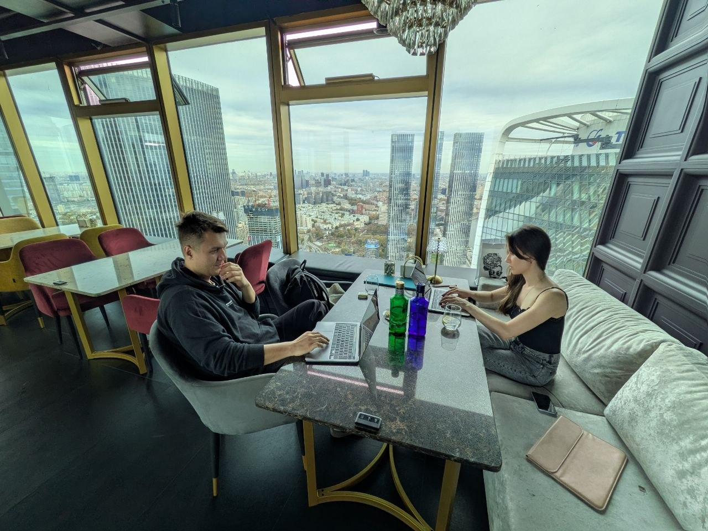

# vibe-салон №1

Первая встреча vibe-салона: оффлайн-сессии вайбкодинга в Москве. Каждый приходит со своей задачей, несколько часов работает над ней вместе с AI и в конце показывает, что получилось.

- Дата: 11 октября 2026
- Место: «Высота 57», Москва-Сити
- Канал салона: [@vibesalon_msk](https://t.me/vibesalon_msk)

## Участники и задачи

| Участник | Задача |
|---|---|
| Дарья Р. ([@DariaMRo](https://t.me/DariaMRo)) | Систематизация своих рабочих процессов, подход к ведению дел с AI. [Итоги](participants/daria/README.md) |
| Фёдор Холькин ([@datawarrior](https://t.me/datawarrior)) | Kit для Google Sheets для дашбордов и визуального слоя, перенос своих лучших практик работы в таблицах в AI. [Итоги](participants/fedor/README.md) |

## Как устроена репа

Каждый участник ведёт свою папку в `participants/`: с чем пришёл, что получилось, что дальше. Следующие встречи получают свои репы `vibe-salon-NN` в организации [vibe-salon](https://github.com/vibe-salon).
